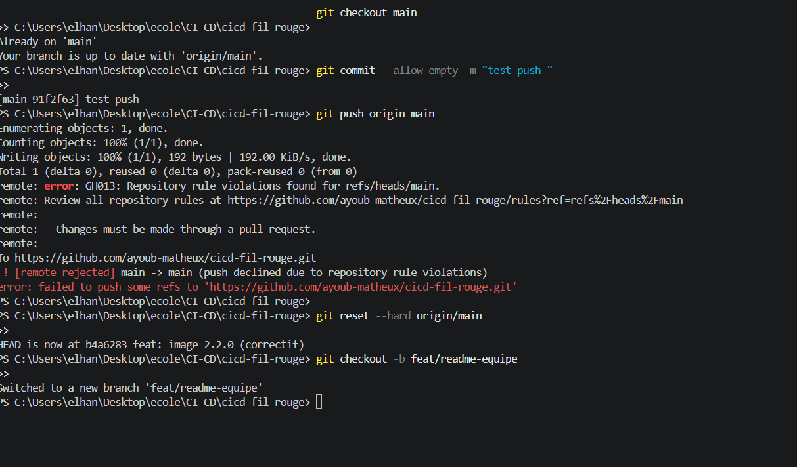
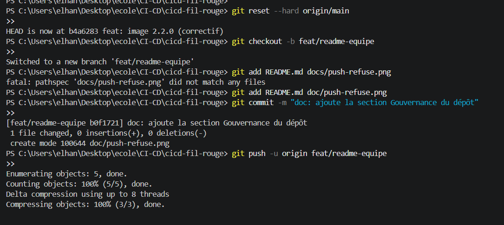

# TaskFlow — dépôt fil rouge CI/CD

TaskFlow est une petite API de gestion de tâches écrite en Python avec FastAPI.
C'est le projet fil rouge du module CI/CD (Mastère DevOps M1, Sup de Vinci) :
pendant trois jours, vous allez construire autour d'elle un pipeline complet
qui teste, construit, sécurise et livre l'application.

## Lancer l'API en local

Prérequis : Python 3.10 ou plus récent.

```bash
python3 -m venv .venv
source .venv/bin/activate          # Windows : .venv\Scripts\activate
pip install -r requirements-dev.txt
uvicorn app.main:app --reload
```

L'API répond sur http://localhost:8000 et sa documentation interactive est sur
http://localhost:8000/docs.

## Vérifier le code

```bash
pytest           # tests automatiques
ruff check .     # lint
ruff format .    # mise en forme
```

## Lancer avec Docker

```bash
docker build -t taskflow .
docker run --rm -p 8000:8000 taskflow
```

## Endpoints

| Méthode | Chemin | Rôle |
| --- | --- | --- |
| GET | `/health` | État de l'API et version |
| GET | `/tasks` | Liste des tâches |
| GET | `/tasks/search?q=...` | Recherche dans les titres |
| POST | `/tasks` | Crée une tâche (`{"title": "..."}`) |
| GET | `/tasks/{id}` | Détail d'une tâche |
| PATCH | `/tasks/{id}/done` | Marque une tâche comme faite |
| DELETE | `/tasks/{id}` | Supprime une tâche (en-tête `X-API-Token` requis) |

## Configuration

| Variable | Rôle | Défaut |
| --- | --- | --- |
| `APP_VERSION` | Version affichée par `/health` | `0.1.0` |
| `DB_PATH` | Fichier SQLite | `taskflow.db` |
| `API_TOKEN` | Jeton exigé pour supprimer une tâche | vide (suppression désactivée) |
| `NOTIFY_WEBHOOK_URL` | Webhook appelé à chaque création de tâche | vide (désactivé) |

## Équipe

<!-- Lab J1 : remplacez par les noms du binôme -->
- À compléter

## Gouvernance du dépôt

La branche `main` est protégée afin que les changements soient vérifiés avant
d'être intégrés :

- Les modifications doivent passer par une pull request (PR). Cela évite les
  changements directs et non relus sur la branche principale.
- Une PR doit recevoir au moins une approbation d'un autre membre de l'équipe.
  Une revue permet de vérifier les changements et de partager leur contexte.
- Les vérifications automatiques `lint` et `test` doivent réussir avant la
  fusion. Une PR qui échoue à l'un de ces contrôles reste bloquée.
- Les push forcés et la suppression de `main` sont interdits pour préserver
  l'historique et éviter la perte de la branche principale.
- Le fichier [`.github/CODEOWNERS`](.github/CODEOWNERS) désigne les responsables
  des workflows GitHub Actions. Leurs changements nécessitent donc une revue
  d'un Code Owner.

La capture ci-dessous montre qu'un push direct sur `main` est refusé par GitHub :
la règle impose de proposer les modifications dans une PR.



La PR de la branche `feat/readme-equipe` vers `main` illustre le parcours de
contribution : la PR est créée et attend une revue avant de pouvoir être
fusionnée.



Dans l'onglet de revue des fichiers, le binôme choisit **Approve** puis soumet
son avis. Cette approbation constitue la validation humaine requise par les
règles de `main`.


Cette PR modifie un workflow : GitHub demande donc une revue au Code Owner. Même
si les contrôles automatiques ont réussi, la fusion reste bloquée tant que cette
approbation n'a pas été donnée.


Une fois l'approbation obtenue, GitHub confirme que les changements sont
approuvés et qu'il n'y a pas de conflit avec `main`. Le bouton de fusion devient
alors disponible.


## Pipeline CI

Le workflow [`.github/workflows/ci.yml`](.github/workflows/ci.yml) s'exécute sur
chaque push et chaque pull request. Il lance deux jobs en parallèle, avec Python
3.12 et les dépendances de développement :

- **Lint (Ruff)** exécute `ruff check .` pour détecter les erreurs de style et
  certains problèmes dans le code.
- **Test (pytest)** exécute `pytest` pour vérifier le comportement de
  l'application.

Les deux jobs doivent réussir pour satisfaire la règle de statut requise par
`main`. Les captures montrent les deux issues possibles :

Les contrôles Ruff et pytest ont réussi sur le dépôt. Les coches vertes
confirment que les vérifications automatiques ont abouti.


Sur cette PR, les checks sont verts, mais la fusion reste bloquée car l'avis du
Code Owner n'a pas encore été soumis. Les tests ne remplacent donc pas la revue
humaine.


Cette PR de test fait échouer Ruff et pytest. GitHub bloque la fusion puisque les
checks requis sont en échec : cela vérifie que la règle protège bien `main`
même lorsqu'une PR casse le lint ou les tests.


L'historique des exécutions Actions permet aussi de voir l'évolution de cette
branche : les premières exécutions sont réussies, puis les exécutions déclenchées
par le push et la mise à jour de la PR échouent après la modification qui casse
les vérifications. Le contrôle s'applique ainsi à la fois au push et à la PR.


